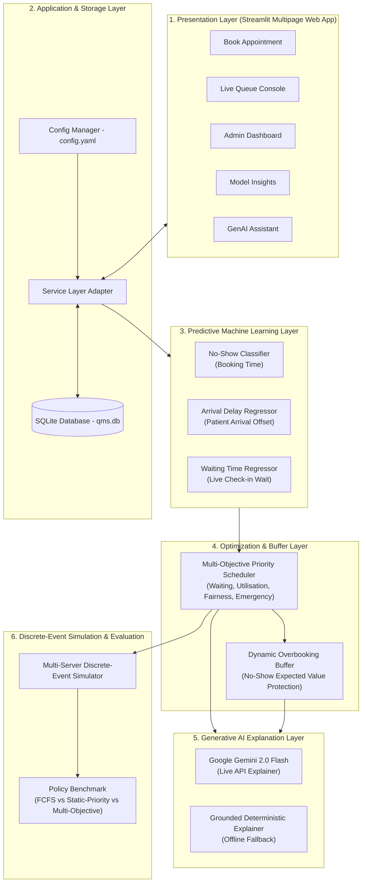

# Multi-Objective AI-Driven Cloud-Based Queue Management System

An **appointment-only** queue manager for healthcare/service clinics that predicts
patient behaviour, schedules against several competing objectives at once, safely
overbooks using no-show forecasts, and explains every decision in plain language.

Every patient books ahead — there are **no walk-ins**. The system needs **no
specialised on-site hardware**: booking, check-in, live status, and the admin
console are all delivered through a single cloud-deployable web app backed by a
lightweight database.

---

## 1. What it does

The system combines three capabilities into one working pipeline:

**Predict.** Three models score every appointment:
- **No-show risk** (classification) — using only information known at *booking time*.
- **Arrival delay** (regression) — how early/late the patient is likely to arrive.
- **Waiting time** (regression) — a live estimate produced at *check-in*.

**Optimise.** A **multi-objective scheduler** decides the serving order to balance
four objectives simultaneously:
- minimise average **waiting** time,
- maximise doctor (server) **utilisation**,
- keep waits **fair** (Jain's index — no starvation),
- protect **emergency** responsiveness.

It is benchmarked against two baselines — **FCFS** and **Static-Priority** (Abusair
et al. style) — on a discrete-event simulation driven by the *real* arrival and
service times, so only the ordering changes (a strictly fair comparison). A
**no-show-aware dynamic buffer** then recommends safe controlled overbooking, up to
the expected number of no-shows per slot.

**Explain.** A **GenAI layer** (Gemini) turns the numbers into short natural-language
rationales for patients and administrators, with a fully **offline deterministic
fallback** so the system never hard-fails without an API key or network.

---

## 2. Research context

This project extends the base paper into a real operational domain:

- **Base paper — Lim & Yu (2025), IEEE ICCBE.** Pairs a numerical optimiser with a
  Gemini-generated natural-language explanation, demonstrated on *synthetic
  marketing* data with a single objective and no learned prediction. We keep its
  optimisation + GenAI skeleton but replace the domain with clinic queues.
- **A-Qyu (2023).** Cloud/mobile queue management with no dedicated on-site
  hardware — motivates our remote-booking, browser-based deployment.
- **Abusair et al. (2021).** Priority queueing and Little's Law in a vaccination
  setting — motivates our emergency priority class and the Static-Priority baseline.

**The gap we fill:** the base paper is single-objective, uses synthetic marketing
data, and has no predictive layer. This system is **multi-objective**, adds a **machine-learning
prediction layer** (no-show / arrival / waiting), and operates on a **real service
domain** — while retaining the optimisation-plus-GenAI-explanation pattern the base
paper introduced.

> **On synthetic data.** The pipeline is developed and validated on a synthetic
> (simulator-generated) dataset. This is standard practice for systems research and
> does not weaken the contribution: the *methods* (leakage-safe features, temporal
> validation, simulation-based policy comparison) are dataset-agnostic. Swap in the
> real CSV and re-run the same three commands — nothing else changes.

---

## 3. System Architecture




### Architectural Layer Breakdown

1. **Presentation Layer (Streamlit App)**:
   - Multipage browser dashboard for patients, clinic staff, and administrators.
   - Handles appointment booking, live check-in, real-time doctor briefing, policy tuning, and interactive Q&A.

2. **Service & Data Persistence Layer**:
   - **SQLite Database (`app/qms.db`)**: Tracks appointments, patient status (`booked`, `checked_in`, `in_service`, `completed`, `no_show`), and live estimates.
   - **Service Layer (`app/service.py`)**: Connects UI views to underlying ML models, schedulers, and GenAI explainer.

3. **Predictive Machine Learning Layer (`src/qms/models/`)**:
   - **No-Show Classifier**: Evaluates cancellation & no-show probability using booking-time features.
   - **Arrival Delay Regressor**: Estimates offset between booked slot time and actual arrival.
   - **Waiting Time Regressor**: Calculates live wait estimation upon patient check-in.

4. **Multi-Objective Scheduler & Dynamic Buffer Layer (`src/qms/optimization/`)**:
   - **Multi-Objective Scheduler**: Optimises patient serving order across 4 weighted objectives: Average Wait Time, Doctor Utilisation, Fairness (Jain's Index), and Emergency Priority.
   - **Dynamic Buffer**: Calculates slot-by-slot controlled overbooking capacity based on expected no-show probabilities.

5. **Generative-AI Explanation Layer (`src/qms/genai/`)**:
   - **Google Gemini 2.0 Flash**: Generates plain-English rationales for queue decisions, arrival predictions, and clinic briefings.
   - **Deterministic Fallback**: Automatically activates when no API key is present or network is unavailable, ensuring 0% hard failure.

6. **Discrete-Event Simulation Layer (`src/qms/simulation/`)**:
   - Replays real clinic schedules under synthetic or historical arrival/service distributions to evaluate scheduling policies fairly.

The code is packaged under `src/qms/`, configured cleanly via `config/config.yaml`.

---

## 4. Project structure

```
queue-management-system/
├── config/config.yaml           # all knobs: paths, weights, thresholds, buffer, genai
├── data/
│   ├── raw/                      # place hospital_dataset_preprocessed.csv here
│   └── processed/                # clean.csv + data_profile.json (generated)
├── src/qms/
│   ├── config.py                 # root resolution + config loader
│   ├── data/                     # loader, leakage-safe preprocess, prepare
│   ├── models/                   # ml_lite (numpy), estimators, metrics, train_all
│   ├── optimization/             # objectives, scheduler policies, dynamic buffer
│   ├── simulation/               # multi-server discrete-event simulator
│   ├── evaluation/               # policy comparison + buffer analysis
│   └── genai/                    # Gemini explainer + offline fallback
├── app/                          # Streamlit app (multipage) + SQLite store + service layer
│   ├── streamlit_app.py
│   └── pages/                    # Book, Live Queue, Admin Dashboard, Model Insights
├── scripts/                      # 01_prepare_data, 02_train_models, 03_run_evaluation
├── tests/test_smoke.py           # end-to-end smoke tests (no pytest/sklearn required)
├── reports/                      # metrics/*.json + figures/*.png (generated)
├── models/                       # trained model bundles (generated)
├── requirements.txt / pyproject.toml / setup.sh
```

---

## 5. Setup

Requires Python 3.9+.

```bash
# option A: one-shot
bash setup.sh

# option B: manual
python -m venv .venv && source .venv/bin/activate
pip install -e ".[ml,app,genai]"     # ml = scikit-learn, app = streamlit, genai = gemini
```

The package is designed to run **even with no optional dependencies**: if
scikit-learn is not installed it transparently falls back to built-in NumPy
learners, and if there's no Gemini key the explainer uses deterministic templates.
Installing the `ml` extra upgrades the models to gradient-boosted trees with **no
code change**.

**GenAI (optional).** Copy `.env.example` to `.env` and set `GEMINI_API_KEY=...`.
Without it, explanations still work (offline templates).

---

## 6. Quickstart

```bash
# 1. put the dataset in place
cp /path/to/hospital_dataset_preprocessed.csv data/raw/

# 2. run the pipeline
python scripts/01_prepare_data.py      # -> data/processed/clean.csv + profile
python scripts/02_train_models.py      # -> models/*.pkl + reports/metrics/model_metrics.json
python scripts/03_run_evaluation.py    # -> reports/metrics/policy_comparison.* + buffer_analysis.json

# 3. launch the app
streamlit run app/streamlit_app.py
```

Run the tests any time with:

```bash
python tests/test_smoke.py        # or: pytest -q
```

---

## 7. Results from a sample run

On the provided dataset (20,000 appointments, 18.8% no-show rate, 2026-04-01 →
2026-05-25), a full pipeline run produced:

**Scheduling policy comparison** (190 department-day queues, 6,512 attended patients;
identical arrival & service times, only ordering varies):

| Policy | Avg wait | Emergency wait | Utilisation | Composite score |
|---|---|---|---|---|
| FCFS | 3.66 min | **4.41 min** | 47.7% | 0.40 |
| Static-Priority | 3.65 min | 1.80 min | 47.7% | 0.46 |
| **Multi-Objective (ours)** | **3.64 min** | 1.81 min | 47.7% | **0.81** |

The priority-aware policies cut **emergency waiting from 4.4 → 1.8 minutes**, and the
Multi-Objective policy gives the best overall balance across all four objectives.

**No-show-aware buffer:** across 1,239 slots, ~80% could safely overbook, for an
estimated **~16% capacity uplift** without expected over-commitment.

> These figures come from a run using the **NumPy-fallback** backend (no
> scikit-learn in that environment). Predictive accuracy improves when the `ml`
> extra is installed; the *scheduling* comparison is independent of model quality
> because it replays real arrival/service times.

---

## 8. Design notes

**Leakage safety.** No-show and arrival-delay models use *only* booking-time
features. The waiting-time model additionally uses `queue_length_at_arrival` (known
at check-in) but never the patient's own realised service time. See
`src/qms/data/preprocess.py`.

**Temporal validation.** Train/test is a time-based split (earliest appointments
train, latest 20% test) to mimic deployment and avoid leaking the future.

**Fair policy comparison.** The simulator holds arrival and service times fixed from
the data and varies only the sequencing decision, so differences are attributable to
the policy alone.

**Configurable trade-offs.** Objective weights, the emergency priority level, the
buffer's base minutes and overbooking cap, model threshold, and the GenAI model are
all in `config/config.yaml`.

---

## 9. Limitations & future work

- Validated on synthetic data; the next step is re-running on real clinic data
  (same commands).
- The scheduler is a fast greedy multi-objective heuristic; a natural extension is a
  formal LP/ILP solver (as in the base paper) for exact Pareto trade-offs.
- Service-time prediction is currently a per-department median; a learned
  service-time model would sharpen the utilisation objective.

---

## 10. References

1. Lim & Yu (2025). *Optimisation with Generative-AI explanations.* IEEE ICCBE. (base paper)
2. A-Qyu (2023). *Cloud/mobile queue management without dedicated hardware.*
3. Abusair et al. (2021). *Priority queueing and Little's Law for vaccination scheduling.*
